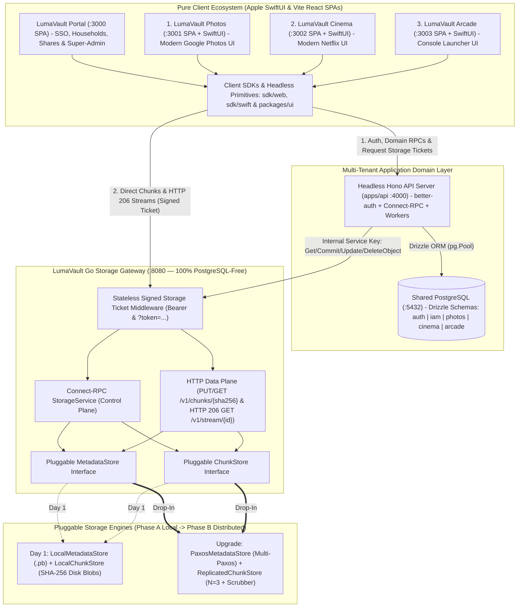

# LumaVault: Product & Architecture Blueprint

**LumaVault** is a self-hosted, multi-tenant distributed storage platform and client application suite (**Apple ecosystem + Web SPAs**) built to replace recurring cloud and media subscriptions (iCloud/Google Photos, 4K streaming services, and cloud game save tiers) across multiple households with granular cross-household sharing, while serving as a hands-on proving ground for distributed systems engineering (**Multi-Paxos**, replicated content-addressed chunk storage, and fault tolerance).

---

## 1. Core Architecture: Pure Go Storage Core + Hono Multi-Tenant App API + Client SPAs/SwiftUI

LumaVault separates **pure distributed object/chunk storage** (modeled after **Google File System (GFS / Colossus)** and **Chubby (Multi-Paxos)**) from **multi-tenant application domain logic & RBAC** (served by a headless **Node.js + Hono** backend over **Connect-RPC** and **Drizzle ORM** on a shared **PostgreSQL** database):

| Layer | Technology Choice | Purpose |
| :--- | :--- | :--- |
| **Monorepo & Codegen** | **Buf** (`buf.yaml`, `buf.gen.yaml`) + `Makefile` + `core/go.mod` + `Package.swift` + `pnpm-workspace.yaml` | Single source of truth for `.proto` contracts (`storage`, `iam`, `photos`, `cinema`, `arcade`); generates Go server stubs, Swift SDK (`sdk/swift`), and TypeScript/Connect-ES descriptors (`sdk/web`). |
| **Storage & Consensus Core** | **Go (Golang)** (`core/internal/metadata`, `core/internal/chunkstore`, `core/internal/consensus`, `core/internal/chunkserver`) | Pure domain-agnostic object & chunk engine: pluggable `MetadataStore` (deterministic `Engine` + `<id>.pb` files -> Multi-Paxos) and `ChunkStore` (`SHA-256` blobs -> $N=3$ replicated chunkservers). |
| **Internal Node-to-Node API** | **gRPC + Protocol Buffers (`proto3`)** | Strictly-typed binary RPCs for Paxos voting (`Prepare`/`Promise`/`Accept`/`Accepted`) and inter-node chunk replication. |
| **Client-Facing Storage Gateway (`:8080`)** | **Go `connectrpc/go` + HTTP Data Plane + Stateless Ticket Auth (`core/internal/gateway`)** | Serves `StorageService` Control Plane RPCs (`< 100 KB`), raw streaming HTTP chunk transfers (`PUT/GET /v1/chunks/{sha256}`), and `HTTP 206` byte-range streaming (`GET /v1/stream/{id}`). Authorizes requests statelessly via short-lived HMAC/Ed25519 **Signed Storage Tickets** (`Bearer` / `?token=...`) with **zero PostgreSQL coupling**. |
| **Headless Multi-Tenant App API (`:4000`)** | **Node.js + Hono + Connect-RPC + `better-auth` + Drizzle ORM (`apps/api`)** | Central headless backend mounting `better-auth` (`/api/auth/*` — SSO cookies, `bearer()` native tokens, `admin()` Super-Admin, `organization()` Households), modular Connect-RPC routers (`/api/rpc/*` — `iam`, `photos`, `cinema`, `arcade`), Drizzle `pgSchema` queries on PostgreSQL (`:5432`), Storage Ticket minting, `TMDB`/`IGDB` proxies, and background workers (`512px` `sharp`/`ffmpeg` thumbnails + Trash sweeper). |
| **Client SDKs & Shared Primitives** | **`@lumavault/sdk` (`sdk/web`)** + **`LumaVaultSDK` (`sdk/swift`)** + **`@lumavault/ui` (`packages/ui`)** | Generated Connect-ES / `@connectrpc/connect-query` & `Connect-Swift` clients, streaming `SHA-256` chunk uploaders with Storage Ticket support, and headless auth/share hooks + CSS-tokenized Radix/`shadcn` primitives (no forced layout shell). |
| **Client Applications (Web SPAs & Apple)** | **Vite + React 19 + TanStack Router/Query + Tailwind v4** & **SwiftUI (`iOS`, `iPadOS`, `tvOS`, `macOS`)** | Pure client-side SPAs (static `dist/` builds, zero SSR servers in prod) and native Apple apps, each with its own tailored design language: **Portal** (`:3000` admin/SSO), **Photos** (`:3001` Google Photos style), **Cinema** (`:3002` Netflix style), and **Arcade** (`:3003` console launcher style). |



---

## 2. Storage Core vs. Multi-Tenant PostgreSQL & RBAC Layer

> [!IMPORTANT]
> **Pure Storage Core (`MetadataStore` + `ChunkStore`) + Multi-Tenant Relational Layer (`apps/api` + `PostgreSQL`):**
> LumaVault's Go storage engine (`core/internal/metadata`, `core/internal/chunkstore`, `core/internal/gateway`, `core/internal/consensus`, `core/internal/chunkserver`) is a **pure content-addressed object and chunk store**. It knows nothing about users, households, albums, TMDB/IGDB catalogs, or playback heartbeats.
> All multi-tenant authentication (`better-auth`), Household quotas/allowances, cross-household resource grants, domain catalogs, and high-frequency user state live in **PostgreSQL** behind the headless **Hono Connect-RPC server (`apps/api`)**, referencing `lumavault_object_id`.

### A. Multi-Tenancy, Households & Stateless Signed Storage Tickets
1. **Three-Tier Identity & Granular RBAC (`auth` & `iam` Schemas):**
   - **Server Super-Admin (`better-auth` `admin()`):** Invites/approves users to create independent **Households** on the server and configures per-household **Allowances** (`max_storage_bytes` quota, enabled app namespaces, upload vs. view-only rights, max member seats, and cross-household sharing entitlements).
   - **Household Tenancy (`better-auth` `organization()`):** Users belong to Households with scoped roles (`OWNER`, `ADMIN`, `MEMBER`, `KID`/`VIEWER`). Content is isolated per household by default, while personal state (`cinema.watch_progress`, `arcade.save_versions`) is isolated per `user_id`.
   - **Cross-Household Resource Grants (`iam`):** Granular ACL shares (`VIEW`, `STREAM`, `DOWNLOAD`, `CONTRIBUTE`, `MANAGE`) let households selectively share Photo Albums/Assets, Movies/Series/Collections, or Console ROMs with another User or Household without exposing private timelines, watch progress, or game saves.
2. **Stateless Signed Storage Tickets on `:8080`:**
   - **Upload Tickets (`Bearer`):** `apps/api` verifies session + upload role + remaining household byte quota and signs a short-lived ticket scoping `HasChunks`, `PUT /v1/chunks/{sha256}`, and `CommitObject` (`namespace`, `max_size_bytes`, `skip_dedup = true`).
   - **Stream / Read Tickets (`?token=...` or `Bearer`):** `apps/api` verifies household ownership or a cross-household share grant and returns short-lived signed URLs/tokens for `GET /v1/stream/{object_id}` (`AVPlayer` / `<video>` `HTTP 206` compatible) and `GET /v1/chunks/{sha256}`.
   - **Internal Service Key:** Privileged `DeleteObject`, `ListObjects`, and `UpdateObjectMetadata` calls on `:8080` require `apps/api`'s server-to-server secret.
3. **Cross-Household Physical Chunk Dedup Without Manifest Coupling:**
   - Multi-tenant commits pass `skip_dedup = true` to `StorageService.CommitObject` so every household owns an independent `ObjectMetadata` manifest (`object_id`)—preventing cross-household delete interference and existence side-channels—while `ChunkStore` still deduplicates **100% of identical `4–64 MiB` `SHA-256` chunks on disk** via `chunkRefs`. Intra-household duplicate prevention is enforced in PostgreSQL (`UNIQUE (household_id, sha256_digest)`).

### B. `ChunkStore` (The Data Plane: Chunking, Deduplication & Safety)
1. **Fixed-Size Content-Addressed Chunks (`4MB–64MB` over Raw HTTP):** Files are sliced into immutable `4MB–64MB` chunks plus thumbnail blobs. The client SDKs pick the chunk size from the file size: start at 4 MiB and double until the file fits in at most 256 chunks, capped at 64 MiB (photos, ROMs, and saves land on 4 MiB; files over 8 GiB land on 64 MiB). The rule is deterministic so identical files always share chunks, streamed in `32KB` buffers (`~32KB` server RAM per active stream). `chunk_size_bytes` on `ObjectMetadata` enables $O(1)$ `HTTP 206` byte-range seeking (`offset / chunk_size_bytes`).
2. **24h GC Lease Renewal:** `HasChunks` and `PutChunk` touch `mtime` (`os.Chtimes`) on existing chunks so slow or resumed uploads receive a fresh 24-hour garbage collection grace window.
3. **Day-1 `LocalChunkStore` -> Drop-In `ReplicatedChunkStore` ($N=3$):** Starts with sharded local disk blobs (`StatChunks` pre-commit size verification + `ReadChunkRange`), upgrading behind `ChunkStore` to $N=3$ gRPC chunkservers, background `SHA-256` bit-rot scrubbing, and predicate-driven GC (`MetadataStore.IsChunkReferenced`).

### C. `MetadataStore` (The Control Plane: Object Manifests & Pluggable Paxos)
1. **Deterministic `metadata.Engine` & `LocalMetadataStore` (`core/internal/metadata/`):** Pure in-memory state machine tracking manifests and $O(1)$ chunk reference counts (`chunkRefs`), persisted atomically per object (`<rootDir>/objects/<id>.pb`).
2. **Drop-In `PaxosMetadataStore` (`core/internal/consensus/`):** Single-Decree and leader-driven Multi-Paxos replicated log (`paxos.proto`) driving `metadata.Engine` with log snapshotting/compaction.

---

## 3. Client SDKs (`sdk/web`, `sdk/swift`) & Headless Shared Primitives (`packages/ui`)

The SDKs let apps upload, download, and stream files through the Storage Gateway without re-implementing chunking, hashing, or the HTTP data plane. Version 1 talks to the gateway as it exists today, with no Signed Storage Tickets yet. The web SDK leads and the Swift SDK mirrors its API.

1. **Web / TypeScript SDK (`sdk/web/` — `@lumavault/sdk`):** One client created from a gateway base URL, for browsers and Node 20 or newer.
   - Upload in one call: split the input (a Blob, File, or Uint8Array) into chunks by the chunk size rule, hash each chunk with Web Crypto and the whole file with hash-wasm, ask `HasChunks` which chunks are missing, upload only those (4 at a time by default), then commit with `skip_dedup` always on. Re-running an upload within the chunk GC grace window re-hashes the file but re-sends nothing.
   - Verified download returns a ReadableStream. Each chunk is checked against its SHA-256 before it is passed on, and the whole-file SHA-256 is checked at the end.
   - Large media saves skip the SDK and use the stream URL as a normal browser download. These are not hash-checked on the client.
   - Builds stream URLs for video players and walks every page of `ListObjects`.
   - Empty files are rejected before any network call.
2. **Swift SDK (`sdk/swift/` — `LumaVaultSDK`):** The same client on URLSession, CryptoKit, and Connect-Swift. It reads files from disk and streams each chunk from the file, so parallel uploads never hold whole chunks in memory. Verified download writes to a file.
   - **Shared rules:** Both SDKs test against the same vectors in `sdk/testdata/chunk-vectors.json`, so they always produce identical chunks and hashes.
   - **Errors:** Every failure is Connect's own ConnectError, in both languages. Data plane HTTP failures map onto Connect codes (400 and 413 to `invalid_argument`, 404 to `not_found`, 500 to `internal`, other 5xx and network failures to `unavailable`, hash mismatch on download to `data_loss`). App-specific errors become typed detail messages in each app's proto, so the error type never grows.
   - **Scope:** The SDKs stay storage-only. App services (`IamService`, `PhotosService`, `CinemaService`, `ArcadeService`) are called through their generated clients, with no hand-written per-app code in the SDKs. `CommitObject` is never retried automatically; an `apps/api` worker cleans up committed objects that Postgres never recorded.
3. **Headless Web Primitives (`packages/ui/` — `@lumavault/ui`):**
   - Exports headless `better-auth` SSO / Household hooks (`useSession`, `useActiveHousehold`, `AuthGuard`), a theme-inheriting `<ShareDialog />`, and CSS-variable Radix/`shadcn` primitives—imposing **zero shared navbar or visual theme** so each SPA owns a distinct product aesthetic.

---

## 4. The Four Web SPAs & Three Media Applications

All web frontends are **pure client-side Vite + React 19 + `@tanstack/react-router` + `@tanstack/react-query` (`@connectrpc/connect-query`) + Tailwind v4 SPAs** talking to `apps/api` (`:4000`) and `core/internal/gateway` (`:8080`), paired with native **SwiftUI** apps:

### Platform Portal: LumaVault Portal (`apps/portal` — `:3000`)
- Central SSO login/registration, Household switcher, member/role invitations, unified Cross-Household Share management, and the **Server Super-Admin Console** (provisioning new households, storage quotas, and app/sharing allowances).

### App 1: LumaVault Photos (`NAMESPACE_PHOTOS` — `:3001` & SwiftUI)
- **Design Identity:** Airy, high-density, minimal-chrome **modern Google Photos** experience.
- **Capabilities:** Keyset-paginated timeline, EXIF camera inspector, geolocation Map view, native Apple Live Photos (`.HEIC` + `.MOV`), household & cross-household shared Albums (`VIEW`, `DOWNLOAD`, `CONTRIBUTE`), in-process `512px` `sharp`/`ffmpeg` async thumbnail worker in `apps/api`, and two-stage deletion (`ACTIVE` -> `TRASHED` -> `STAGED_FOR_DELETION` -> `DeleteObject`).

### App 2: LumaVault Cinema (`NAMESPACE_CINEMA` — `:3002` & SwiftUI incl. `tvOS`)
- **Design Identity:** Deep dark, full-bleed **modern Netflix** theatrical experience with hero billboards and horizontal carousels.
- **Capabilities:** Instant 4K HDR scrubbing over `64MB` chunks (`HTTP 206`), server-side TMDB metadata/artwork enrichment, `Series -> Season -> Episode` hierarchy, cross-household Movie/Series/Collection sharing (`STREAM` + `KID` rating filters), and per-user `playback_position_ms` Continue Watching sync.

### App 3: LumaVault Arcade (`NAMESPACE_GAMES` — `:3003` & SwiftUI)
- **Design Identity:** Tactile **retro/modern console & emulator launcher** with cartridge/box-art shelves and save-slot cards.
- **Capabilities:** Console library (`GBA`, `NDS`, `N64`, `SNES`, `GBC`, `NES`) with server-side Twitch/IGDB box art, cross-household ROM sharing, cryptographically verified download + one-tap **Delta** (`com.rileytestut.Delta`) handoff, per-user monotonic `.sav`/`.svs` save versioning (`v1, v2, v3...`), and zero-upload server-side save rollback.

---

## 5. Linear Project Structure

Work is organized in Linear under team Lumavault (`LUM`) across 7 projects, listed in execution order. Linear holds the live roadmap: milestones, issues, and idea issues for future features (see AGENTS.md). This section only records the project layout, so it does not drift from Linear.

App projects (Photos, Cinema, Arcade) follow a contract-first pattern. Their first milestone defines the `.proto` contract and Drizzle schema. That unlocks the backend, web app, and Apple app milestones, which run in parallel worktrees.

1. Core Backend, Contracts & Basic Data Layer (`P-LUM-1`)
2. Client SDKs, Web/TypeScript & Swift (`P-LUM-2`)
3. App Platform, Auth & Multi-Tenant RBAC (`P-LUM-7`)
4. LumaVault Photos (`P-LUM-3`)
5. LumaVault Cinema (`P-LUM-4`)
6. LumaVault Arcade (`P-LUM-5`)
7. Distributed Systems Upgrades, Paxos & Chunkservers (`P-LUM-6`)

---

## 6. Monorepo Directory Structure (`~/repos/lumavault`)

```text
lumavault/
├── AGENTS.md                         # AI agent & multi-worktree development rules
├── Makefile                          # build, test, run, proto, lint
├── pnpm-workspace.yaml               # Links sdk/web, packages/ui, apps/api, apps/portal, apps/*/web
├── docker-compose.yml                # Shared PostgreSQL (:5432 - auth, iam, photos, cinema, arcade schemas)
├── buf.yaml                          # Protobuf module & linter configuration
├── buf.gen.yaml                      # Generates Swift (sdk/swift) and Web/Node (sdk/web) stubs
├── buf.gen.go.yaml                   # Generates Go Storage Core stubs (core/gen/go)
├── go.work                           # Go workspace, so go commands run from the repo root
├── Package.swift                     # Swift Package for iOS, iPadOS, tvOS, macOS
├── docs/
│   └── BLUEPRINT.md                  # Product & Architecture Blueprint
├── proto/lumavault/
│   ├── v1/                           # Storage Core, Paxos & Chunkserver contracts (storage, paxos, chunk)
│   ├── iam/v1/iam.proto              # Households, Allowances, Cross-Household Grants & Storage Tickets
│   ├── photos/v1/photos.proto        # PhotosService Connect-RPC contract
│   ├── cinema/v1/cinema.proto        # CinemaService Connect-RPC contract
│   └── arcade/v1/arcade.proto        # ArcadeService Connect-RPC contract
├── core/                             # Go Storage Core module: github.com/lumavault/lumavault/core
│   ├── go.mod
│   ├── cmd/lumavault/main.go         # Go Storage Gateway server entrypoint (:8080)
│   └── internal/
│       ├── constants/                # Shared storage invariants (chunk size, SHA-256 hex length)
│       ├── validate/                 # Shared request checks (SHA-256 digests, namespaces, object IDs, commit manifests)
│       ├── metadata/                 # MetadataStore interface + deterministic Engine + LocalMetadataStore
│       ├── chunkstore/               # ChunkStore interface + LocalChunkStore (SHA-256)
│       ├── ticket/                   # Signed Storage Ticket claims + verifier
│       ├── gateway/                  # Connect-RPC Control Plane + HTTP Data Plane + Stateless Ticket Auth
│       ├── consensus/                # Single-Decree & Multi-Paxos (PaxosMetadataStore)
│       └── chunkserver/              # Replicated chunk storage & bit-rot scrubber (ReplicatedChunkStore)
├── sdk/
│   ├── web/                          # @lumavault/sdk (Connect-ES/Query + "./gen/*" + Web Crypto chunker)
│   └── swift/                        # LumaVaultSDK (Storage + App Connect-Swift clients + CryptoKit chunker)
├── packages/
│   └── ui/                           # @lumavault/ui (Headless auth/share hooks + CSS-tokenized primitives)
└── apps/
    ├── api/                          # Headless Node.js + Hono Backend (:4000 - better-auth, Drizzle, Routers, Workers)
    ├── portal/                       # LumaVault Portal Vite SPA (:3000 - SSO, Households, Shares & Super-Admin)
    ├── photos/                       # App 1: web/ (Vite SPA :3001 - Google Photos UI) + apple/ (SwiftUI)
    ├── cinema/                       # App 2: web/ (Vite SPA :3002 - Netflix UI) + apple/ (SwiftUI incl. tvOS)
    └── arcade/                       # App 3: web/ (Vite SPA :3003 - Console Launcher UI) + apple/ (SwiftUI)
```
